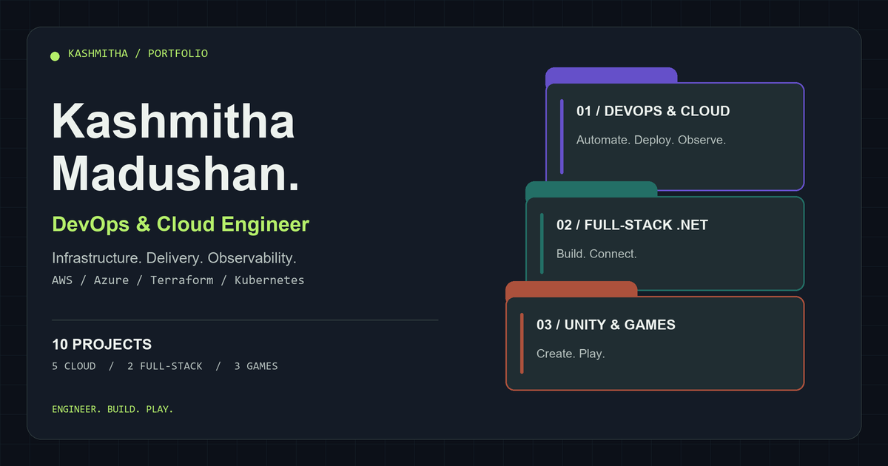

# Kashmitha Madushan — Portfolio

A personal portfolio focused on DevOps and Cloud engineering, with full-stack .NET applications and Unity game development projects. Built with React, TypeScript, and Vite, using an interactive folder-inspired interface.



## Features

- Six sections: Cover, Contents, About, Projects, Process, and Contact.
- Ten curated projects: five DevOps and Cloud, two full-stack .NET, and three Unity games.
- Category filters, illustrated project previews, and project detail viewers with repository links.
- About biography, three role cards, and current work experience at Port City BPO.
- LinkedIn and GitHub links with recognizable brand icons.
- Responsive layouts, persistent light/dark themes, and animated outline lettering.
- Keyboard navigation, modal focus management, and reduced-motion support.
- Contact form powered by Formspree, with submission feedback and saved message drafts.
- Download CV controls on the cover and Contact section, serving the current CV as a PDF.
- Open Graph and large-image social-sharing metadata with a custom 1200×630 preview.
- Local time displayed for Colombo, Sri Lanka.

## Technologies

| Area | Tools |
| --- | --- |
| Frontend | React 19, TypeScript, Vite |
| Styling | Custom CSS, SVG, Lucide React icons |
| Contact delivery | Formspree |
| Browser testing | Playwright |
| Formatting | Prettier |
| Hosting target | Cloudflare Pages |

Project content is stored in TypeScript. The current application does not require a custom backend or database. The `api/` directory is reserved for future development.

## Project structure

```text
personal-portfolio/
├── README.md
├── .gitignore
├── api/
│   └── .gitkeep
└── web/
    ├── public/
    │   ├── cv.pdf
    │   ├── favicon.svg
    │   ├── portrait.png
    │   └── social-preview.png
    ├── src/
    │   ├── components/
    │   │   ├── ContactForm.tsx
    │   │   ├── CvDownload.tsx
    │   │   ├── FolderPortfolio.tsx
    │   │   ├── ProjectVisual.tsx
    │   │   └── SocialLogo.tsx
    │   ├── data/
    │   │   └── portfolio.ts
    │   ├── App.tsx
    │   ├── main.tsx
    │   ├── styles.css
    │   ├── template.css
    │   └── project-visual.css
    ├── tests/
    │   └── portfolio.spec.ts
    ├── index.html
    ├── package.json
    ├── package-lock.json
    ├── playwright.config.ts
    ├── tsconfig.json
    └── vite.config.ts
```

## Local development

Use Node.js 24 LTS and npm. Run these commands from the repository root:

```sh
npm --prefix web ci
npm --prefix web run dev
```

Open the local URL printed by Vite, normally `http://localhost:5173`.

## Quality checks

```sh
npm --prefix web run typecheck
npm --prefix web run build
npm --prefix web run format:check
```

Run the desktop and mobile browser suite using installed Microsoft Edge.

**Command Prompt:**

```cmd
set "PLAYWRIGHT_CHANNEL=msedge"
npm --prefix web test -- --workers=2
```

**PowerShell:**

```powershell
$env:PLAYWRIGHT_CHANNEL = 'msedge'
npm --prefix web test -- --workers=2
```

Alternatively, from `web/`, run `npx playwright install chromium` and `npm test` with `PLAYWRIGHT_CHANNEL` unset.

To format the frontend:

```sh
npm --prefix web run format
```

To serve a production build locally:

```sh
npm --prefix web run build
npm --prefix web run preview
```

## Content and configuration

### Profile and projects

Edit `web/src/data/portfolio.ts` for profile links, experience, and project data. Section copy, role cards, and workflow content are configured in `web/src/App.tsx`.

The project previews are concept illustrations rather than application screenshots or live infrastructure metrics.

### CV download

The current CV is served from `web/public/cv.pdf` as a static PDF; no API is needed. Both Download CV controls use `profile.resume`, currently set to `/cv.pdf`, and save the file as `Kashmitha_Madushan_Associate_DevOps_CV.pdf`.

To update it, replace `web/public/cv.pdf` with the latest PDF and check both Download CV controls before publishing.

After deployment, the PDF is available at `https://YOUR_DOMAIN/cv.pdf`. Setting `profile.resume` to an empty string disables the controls and displays “Available soon”.

### Contact form

The contact form posts to the public Formspree endpoint configured in `web/src/components/ContactForm.tsx`. Recipient settings and spam controls are managed in Formspree. The visitor supplies a reply email, but the form does not verify ownership of that mailbox.

The message draft is stored locally under `portfolio-draft`. Name and email fields are not saved to local storage. Accepted submissions clear the draft; failures preserve it. The selected theme uses `portfolio-theme`.

### Sharing metadata

Set the public, nonsecret `VITE_SITE_URL` to the final HTTPS website URL before building for production. Configure it in the hosting environment or an ignored local environment file under `web/`.

The build uses this value for the canonical URL, Open Graph page URL, and absolute social image URLs. Without it, local development uses `/social-preview.png` and omits the canonical/page URL. HTTPS URLs must not contain credentials, query parameters, or fragments.

## Cloudflare Pages

Cloudflare Pages is the selected hosting platform. Deployment and the custom domain are not configured yet.

| Setting | Value |
| --- | --- |
| Repository | `Kashmitha/personal-portfolio` |
| Production branch | `main` |
| Root directory | `web` |
| Build command | `npm run build` |
| Build output | `dist` |
| Node version | `24` |
| Public URL variable | `VITE_SITE_URL` |

Connect the GitHub repository to Pages, configure the settings above, and set `VITE_SITE_URL` to the actual public HTTPS address. A custom domain can be registered separately through Name.com and connected using Cloudflare's custom-domain setup.

After publishing, verify both themes, mobile layouts, project links, CV download, contact delivery, and social-sharing previews.

## Attribution

The folder layout and original interactions are adapted from **Folder Tab Portfolio Template** by **Kedhareswer Naidu (@kedhareswer)**.

[Original template source](https://github.com/Kedhareswer/21stdev-my-components/blob/f8a5636d294cdf059f1d44b6acab1f70aaa2c915/components/folder-tab-portfolio-template/folder-tab-portfolio-template.tsx)

The original source and usage notice are retained in `web/src/components/FolderPortfolio.tsx`.

## Links

- [GitHub](https://github.com/Kashmitha)
- [LinkedIn](https://www.linkedin.com/in/kashmitha-madushan-362822339/)
